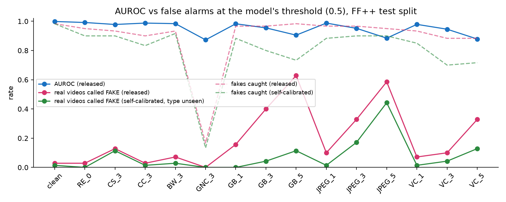
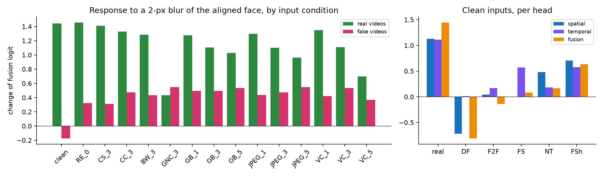
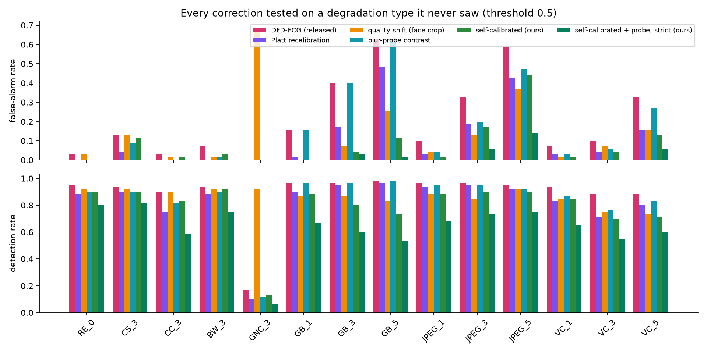
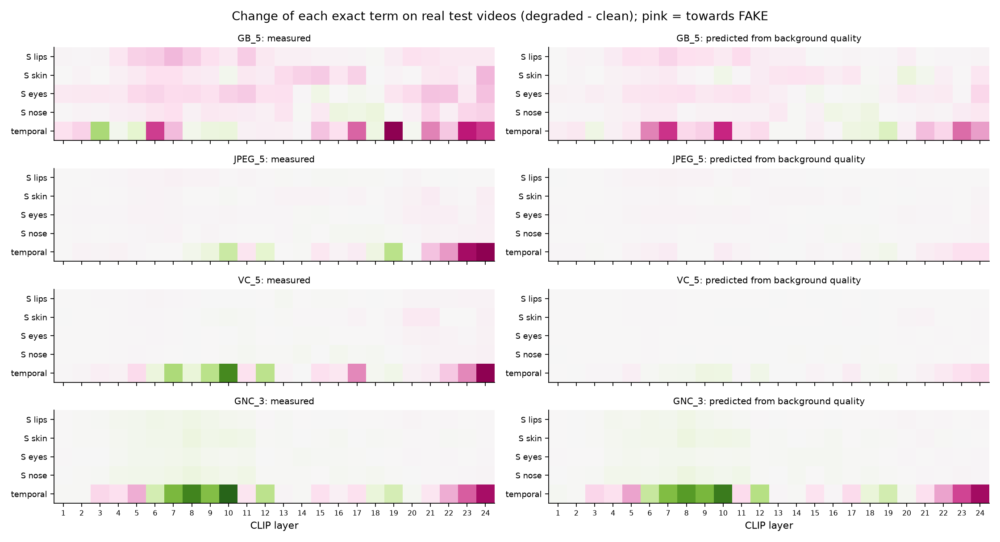

# Fake, or just compressed? Self-calibrating DFD-FCG

An extension of **DFD-FCG** (Han, Huang, Hua, Chen, *CVPR 2025*), the video deepfake detector built on a
frozen CLIP ViT-L/14. B.Tech project by Roshan Raj, building on our earlier exact-attribution study
([dfd-fcg-explainability](https://github.com/roshanraj9136/dfd-fcg-explainability)).

* **Video checker (Vercel):** https://dfd-fcg-degrade-to-detect.vercel.app · upload a face video, get REAL / FAKE, a short reason and a "sure / not sure" label (version 2: every person, 8 clips from 10 s; [accuracy study](results/accuracy_study.md))
* **Viva guide (Vercel):** https://dfd-fcg-viva.vercel.app · the problem, the cause, the fix and the architecture in plain language
* **Checker backend (Hugging Face ZeroGPU):** https://huggingface.co/spaces/roshan9136/dfd-fcg-checker
* **Results API (Render):** https://dfd-fcg-degrade-to-detect-api.onrender.com/api/health · **Database:** Neon Postgres

<!-- RESULTS-START -->
## Results at a glance

FF++ *test split* (70 real, 60 fake: Deepfakes, Face2Face, FaceSwap, NeuralTextures), the authors' perturbation
protocol (7 types; blur, resampling and H.264 at 3 severities, the others at 1), plus a re-encode-only control.
Rules were fitted on disjoint *train-split* videos at other severities; "type unseen" also hides the tested
degradation type from fitting. Numbers are means over the 13 degraded conditions.

| | released DFD-FCG | self-calibrated (ours), type unseen |
|---|---|---|
| AUROC, degraded conditions (what the paper reports) | 0.946 | 0.945 |
| real videos called FAKE at the model's threshold | **22.5%** (worst: 63% under strong blur) | **8.7%** (worst 44%) |
| fakes caught at the threshold | 87.9% | 78.1% |
| balanced accuracy | 82.7% | 84.7% |
| fakes caught at a 5% / 10% / 20% false-alarm budget | 67.2% / 77.6% / 85.9% | 71.0% / 80.5% / 85.8% |
| AUROC when all conditions are ranked together | 0.920 | **0.951** |
| clean test videos: AUROC, false alarms, fakes caught | 0.999, 2.9%, 98.3% | 0.999, 1.4%, 98.3% |

Strong blur (GB_5): 63% → 11% false alarms, 98% → 73% fakes caught. The cost is real: at the 0.5 threshold the
corrected model catches fewer fakes, also on FaceShifter, a manipulation DFD-FCG never saw (73% → 53%, AUROC
unchanged at 0.925). Strict mode (self-calibration + blur probe) brings false alarms under degradation to 2.3% and
catches 61% of fakes.

**Blur probe (finding 2).** On clean video a 2-px blur of the aligned face changes the fusion logit by **+1.44**
on real videos and **−0.17** on fakes (Deepfakes −0.81, Face2Face −0.14, FaceSwap +0.08, NeuralTextures +0.16).
The response alone separates real from fake with AUROC 0.992. The gap shrinks on already degraded input
(0.66–0.94) and on DFDC (0.74), and noise reverses it.

**Explanation at scale (finding 4).** From the exact attribution of clean fakes alone, a linear classifier names
the manipulation method of 79 videos with 77% accuracy (identity-grouped 5-fold; 57% from the three head logits,
25% chance). Identity swaps are carried by the eyes component (Deepfakes 40%, FaceSwap 51% of spatial evidence),
re-enactments by the skin (Face2Face 33%, NeuralTextures 31%). On FaceShifter the spatial branch alone catches
only 40% of fakes, the temporal branch 80%.

**Exactness.** Over all 5,976 clips, the 240 layer × component terms reproduce each head's logit to 3·10⁻⁷ and the
per-patch maps to 8·10⁻⁴ (fp16 inference; P(FAKE) within 6·10⁻⁴ of the model's own output).

Full tables for every rule and protocol: [`results/tables.md`](results/tables.md); every number:
[`results/metrics.json`](results/metrics.json), [`results/analysis.json`](results/analysis.json).

| | |
|---|---|
|  |  |
|  |  |
<!-- RESULTS-END -->

---

## What is new compared with the paper and with our earlier work

| | DFD-FCG paper | our earlier work | this repository |
|---|---|---|---|
| robustness metric | AUROC per perturbation | 2 videos | AUROC **and** the false-alarm / detection rate at the model's own threshold, per condition and mixed |
| scale | – | 1 real + 1 fake video | FF++ test split (real, Deepfakes, Face2Face, FaceSwap, NeuralTextures), FaceShifter, DFDC; 15 conditions |
| explanation | attention maps | exact additive attribution | exact attribution of **how each verdict changes** under degradation and under a test-time probe |
| decision rule | fixed | – | self-calibration from the model's own features; optional probe-based strict mode |

## The four findings

1. **AUROC hides a calibration collapse.** Under the authors' own perturbation protocol AUROC stays high,
   but at the native threshold blur, resampling and H.264 make the model call a large share of *authentic*
   videos fake. Gaussian noise does the opposite and hides fakes.
2. **Real and fake videos react differently to a blur.** Blurring the aligned face by 2 px adds a lot of
   FAKE evidence to real videos and almost none to fakes. Part of what DFD-FCG treats as evidence of
   authenticity is fine natural detail, and every degradation removes it. That is the mechanism behind
   finding 1.
3. **Where it enters the model.** The exact per-layer, per-component and per-patch terms show which parts
   of the three heads the degradation shifts (`results/figures/f3_drift_anatomy.png`).
4. **The earlier two-video findings, re-tested.** Some hold, some do not (see the website, section
   *Replication*). New at scale: identity swaps are caught on the eyes, re-enactments on the skin, and the
   explanation alone names the manipulation method far above chance.

## The method: self-calibrated DFD-FCG

The heads of DFD-FCG read a 1024-d spatial feature `y_s` and a 256-d temporal feature `y_t`. These features
also encode how degraded the face is. A ridge read-out predicts, from them, the spurious evidence the
degradation adds to each head, and it is subtracted:

```
g = W · standardise([y_s, y_t]) + b          (3 numbers: spatial, temporal, fusion)
d'_h = d_h − g_h                               P = (σ(d'_s) + σ(d'_t) + σ(d'_a)) / 3,  threshold 0.5
```

The training target is **class-agnostic**: for a training clip under condition *c* it is the average
paired shift (degraded − clean) that *c* causes on real training videos (0 for clean), for real and fake
clips alike. The read-out learns "which degradation, how strong", never "real or fake". It is fitted on FF++
*train-split* videos at severities 2 and 4; all evaluation uses the disjoint *test split* at severities 1, 3
and 5, and the strictest protocol also hides the tested degradation type. The released checkpoint is not
changed.

**Strict mode** subtracts half of the blur-probe response on top (`d''_h = d'_h − 0.5 · (d_h(blur(x)) − d_h(x))`):
one extra forward pass, far fewer false alarms, lower detection. It is an operating mode, not a free gain.

## What did not work

* **Quality measured on the background.** A face manipulation never touches the pixels around the face, so
  we regressed every exact term's shift on blur/noise/blocking/colour measured there. Background sharpness
  varies more between videos than within a video under compression, and the correction does not transfer to
  unseen degradation types.
* **The blur probe as the fix.** On clean video the response separates real from fake almost perfectly, but on
  degraded video the gap shrinks. At an equal false-alarm budget the probe contrast detects no more fakes than
  moving the released threshold.

## Reproducing

Requirements: a CUDA GPU (4 GB is enough; everything here ran on an RTX 3050 Ti laptop), Python 3.12,
PyTorch 2.6, the upstream code and checkpoint.

```bash
git clone https://github.com/aiiu-lab/DFD-FCG ../DFD-FCG          # model code (+ misc/)
# put the authors' weights.ckpt in ../DFD-FCG/checkpoint/  (or set DFD_FCG_CKPT)
pip install torch torchvision face-alignment av opencv-python scikit-learn scipy matplotlib \
            huggingface_hub lightning open_clip_torch

# FaceForensics++ splits (official) and videos (public c23 mirror; accept the FF++ terms of use)
mkdir -p ../data/splits && for s in train val test; do
  curl -sL https://raw.githubusercontent.com/ondyari/FaceForensics/master/dataset/splits/$s.json -o ../data/splits/$s.json; done
python -m qa.manifest            # select + download
python -m qa.subset              # compute budget used here (196 FF++ videos)
python -m qa.cross               # 80 DFDC videos (cross-dataset)

python -m qa.run_pipeline        # face alignment + DFD-FCG with exact attribution, all conditions and probes
python -m qa.report              # table -> metrics -> analyses -> figures -> website data
python tests/check_table.py      # every head logit == sum of its exact terms + constant
```

`python -m qa.run_video some_video.mp4 [--degrade GB_5]` runs the released model, the self-calibrated
model and the probe on any video.

### Deploying

```
browser ── checker site (web/checker, Vercel) ──video──▶ Hugging Face Space, ZeroGPU (service/space)
                                                           find every face (CPU) → DFD-FCG on 8 clips per face + blur test
                                                           (ZeroGPU, CPU fallback) → self-calibration → most suspicious face
                                                           → "sure / not sure" + explanation
                                                           ◀── weights from a private HF model repo (research use only)
                                                           ──▶ Neon Postgres: anonymous log (table analyses)
browser ── viva site (web/viva, Vercel) ──▶ results API (web/api, Render) ──read-only──▶ Neon Postgres (kv, videos)
```

* **Checker backend (Hugging Face Space on ZeroGPU):** `service/space/build.ps1` assembles the Space folder
  (Gradio app + `service/app` pipeline + the `qa` modules it needs). Space secrets: `HF_TOKEN` (read access to
  the private repo holding `weights.ckpt`, CLIP ViT-L/14 and the face-alignment weights) and `DATABASE_URL`
  (a Neon role that may only insert into and count `analyses`). API: `/analyze` (file, degrade = none | blur |
  compress) and `/health`, e.g. with `@gradio/client`. Face detection and alignment run on the Space's CPU; only
  the DFD-FCG passes (detector + blur test) book a ZeroGPU slot, with a duration that grows with the number of
  passes (faces × clips). If ZeroGPU refuses (quota used up, no free GPU), the same passes run on a CPU copy of
  the model loaded at startup: same scores, slower (about a minute per video).
  **Version 2 settings** (`service/app/pipeline.py`, environment variables): `CLIPS=8`, `WINDOW_SEC=10` (8 clips
  from the first 10 s), `MAX_FACES=2` (every clear face; the most suspicious decides), `FLIP_TTA=0`,
  `CERT_MARGIN=0.16` ("not sure" when the corrected score is within 0.16 of 0.5). `CLIPS=2 WINDOW_SEC=0
  MAX_FACES=1` reproduces version 1 (= the research clip layout) exactly. The settings were chosen on 117 videos
  that are in no reported result and then tested once on the 225 test videos: `service/study/` and
  [results/accuracy_study.md](results/accuracy_study.md).
  Hugging Face only allows Gradio/Docker Spaces on free accounts with ZeroGPU; `service/Dockerfile` +
  `service/app/main.py` is the same pipeline as a plain CPU FastAPI container for any Docker host.
* **Database (Neon Postgres):** tables `kv` and `videos`; `NEON_OWNER_URL=... python web/api/seed.py` loads
  `web/frontend/public/data`. The API only needs a read-only role.
* **API (Render):** [](https://render.com/deploy?repo=https://github.com/roshanraj9136/dfd-fcg-degrade-to-detect)
  uses `render.yaml` (root `web/api`); set `DATABASE_URL` to the read-only Neon URL when asked. Live at
  https://dfd-fcg-degrade-to-detect-api.onrender.com (free plan: the first request after idle takes up to a minute).
  The same FastAPI app also runs on Vercel as a backup (`web/api/vercel.json`).
* **Websites (Vercel):** `web/checker` (env `VITE_CHECKER_SPACE`, default `roshan9136/dfd-fcg-checker`) and
  `web/viva` (static; its live-numbers button calls the Render API). The original research site with every
  table and the per-video explorer is kept in `web/frontend` (env `VITE_API_URL`).

### Layout

```
qa/
  manifest.py, subset.py, cross.py   video selection (official FF++ splits, DFDC part 0)
  prep.py                            upstream face alignment (2D-FAN, main-face tracking, LRW mean face)
  conditions.py                      the authors' perturbation protocol (+ re-encode control) and probes
  probes.py                          test-time probes applied to the aligned face
  engine.py                          DFD-FCG + exact additive attribution of all three heads
  quality.py                         label-free image-quality descriptors (face crop and background)
  extract.py, run_pipeline.py        resumable extraction on one small GPU
  methods.py                         every decision rule compared
  evaluate.py                        metrics, unseen-type and cross-validation protocols, matched-FPR analysis
  analysis.py                        replication, drift anatomy, fragility, fingerprints
  figures.py, export.py, report.py   figures, website data
  run_video.py                       any video, end to end
tests/                               crop and exactness checks
service/app                          checker pipeline for uploaded videos (face → DFD-FCG → self-calibration → blur test)
service/space                        Hugging Face Space (Gradio, ZeroGPU) wrapper; service/Dockerfile = CPU container
service/study                        accuracy study for version 2 (selection set, per-clip scores, reports)
web/checker                          upload-and-check site (Vercel)
web/viva                             plain-language viva guide with SVG figures (Vercel)
web/frontend                         original research site with all tables (React + Vite)
web/api                              FastAPI (Render blueprint in render.yaml; also deployed on Vercel), reads Neon Postgres
results/                             metrics.json, analysis.json, figures
```

## Limitations

* Compute: one 4 GB laptop GPU. 2 clips of 10 frames per video, the first 144 frames, a subset of the FF++
  test split; every number is from a single run without confidence intervals.
* FF++ train-split videos used to fit the read-out were seen by DFD-FCG during training, so their scores are
  more confident than on new videos; the cross-validation protocol on the test split avoids this.
* The ridge strength (α = 1000) and the strict-mode weight (0.5) were set after a pilot on part of the test
  data.
* DFDC videos come from training part 0 of DFDC, not its official test split, so the DFDC numbers are not
  comparable with the paper's table; they compare the released and the corrected rule on the same videos.
* Perturbations are applied to a region around the face before re-encoding, so encoder rate control differs
  slightly from re-encoding the full frame.

## License and data

MIT for the code in this repository; see [NOTICE](NOTICE). DFD-FCG code and weights are released by their
authors for research purposes only. FaceForensics++ and DFDC frames are not redistributed.

```bibtex
@inproceedings{cvpr25_dfd_fcg,
  title={Towards More General Video-based Deepfake Detection through Facial Component Guided Adaptation for Foundation Model},
  author={Yue-Hua Han and Tai-Ming Huang and Kai-Lung Hua and Jun-Cheng Chen},
  booktitle={CVPR}, year={2025}
}
```
